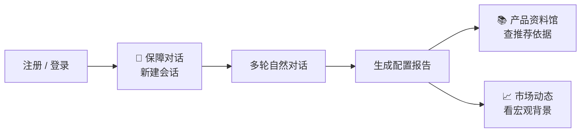

# 中国人寿海外保险配置助手 · hkia-assistant

> **顾问式对话 → 理解保障需求 → 生成配置说明报告 → 查产品资料与市场动态**  
> 面向香港保险配置场景的 AI Agent，像顶级顾问一样聊需求，而不是填固定问卷。

<p align="center">

[](https://www.python.org/)
[](https://nextjs.org/)
[](https://react.dev/)
[](https://fastapi.tiangolo.com/)
[](https://github.com/zhaoyixuanyxz/hkia-assistant)

</p>

---

## 你能用它做什么？

| 需求 | 系统帮你 |
|------|----------|
| 想聊清楚自己的保障背景，而不是填表 | **保障对话** — 多轮自然语言，Agent 逐步理解画像 |
| 需要一份可读的配置说明 / 报告 | 对话后 **生成报告**（含图表与免责声明） |
| 想了解国寿海外香港有哪些产品 | **产品资料馆** — 全文 + 向量检索 |
| 想看汇率、宏观、监管等市场信息 | **市场动态** — 结构化情报入口 |
| 第一次用，不知道从哪开始 | 顶栏 **使用指南** + 公共 `/guide` 操作说明 |

> 💡 **一句话**：对话负责「懂客户」；报告负责「讲方案」；资料馆和市场负责「查依据」。

---

## 5 分钟上手（Windows · Docker 推荐）

### ① 准备三样东西

- **Docker Desktop**（[docker.com](https://www.docker.com/products/docker-desktop/)）
- **DeepSeek API Key**（[platform.deepseek.com](https://platform.deepseek.com) 申请；无密钥时可设 `USE_MOCK_LLM=true` 本地演示）
- 根目录复制 **`.env.example` → `.env`**，至少填写 `JWT_SECRET` 与（可选）`DEEPSEEK_API_KEY`

### ② 一键启动

**双击** `start.bat`，按提示选地区：

| 选项 | 适用 |
|------|------|
| **1** 境内 | 使用 `docker.cn.env` 镜像加速 |
| **2** 境外 / 港 / 澳 | 使用 `docker.intl.env` |

也可直接双击 `start-cn.bat` 或 `start-intl.bat`。

浏览器会自动打开 **http://localhost:3000**  
API 健康检查：**http://localhost:8000/health** · 文档：**http://localhost:8000/docs**

> ⚠️ 首次启动会拉镜像并 build，可能需要数分钟。  
> 关掉了？重新双击 `start.bat`；完全停止服务用 **`关闭全栈.bat`**。

### ③ 第一次登录

打开 **注册** 创建账号 → 进入 **保障对话** → **新建会话** → 聊几轮 → **生成报告**。

---

## 不用 Docker？开发者本地启动

需要 **两个终端**（Node.js LTS + Python 3.11+）：

```powershell
# 终端 1 — 后端
cd backend
pip install -e ".[dev]"
uvicorn app.main:app --reload --host 0.0.0.0 --port 8000

# 终端 2 — 前端
cd frontend
npm install
npm run dev
```

> 项目路径含中文时，前端已固定 `--webpack` 构建，避免 Turbopack 报错。

---

## 给他人使用 · 方案 A（试点最快）

**你托管，同事只开浏览器** — 不用装 Docker、不用自己申请 API Key。

| 你是谁 | 做什么 |
|--------|--------|
| **管理员（你）** | 本机 `start.bat` 常开 → 用 **Tailscale** 或 **Cloudflare 隧道** 发链接 |
| **使用者** | 打开链接 → 注册/登录 → 顶栏「使用指南」按流程用 |

```text
快速试点（对方零安装）：
  1. 本机配置好 .env 并 start.bat 启动
  2. 用 Tailscale 发 http://100.x.x.x:3000
     或 Cloudflare Tunnel 发 https://xxx.trycloudflare.com
  3. 把链接发给同事
```

> 缺点：你电脑得常开；数据在你本机数据库里。详见 `vibe coding.txt` 方案 A。

---

## 24 小时在线 · 你关机也能用（方案 B，推荐长期）

**Docker + 便宜云主机（约 ¥45～50/月）**，同事只打开 `http://公网IP:3000`。

```bash
# 在 Ubuntu 云服务器上
git clone https://github.com/zhaoyixuanyxz/hkia-assistant.git && cd hkia-assistant
cp .env.example .env          # 填入 JWT_SECRET、DEEPSEEK_API_KEY 等
docker compose --env-file docker.intl.env up -d --build
```

云防火墙放行 **3000**（前端）端口；生产环境务必更换默认数据库口令与 `JWT_SECRET`。

> 更新：本机改代码 → `git push` → 服务器 `git pull && docker compose up -d --build`。详见 `vibe coding.txt` 方案 B。

---

## 界面长什么样？四个入口够用

```
┌─────────────┬─────────────┬─────────────┬─────────────┐
│  💬 保障对话 │  📚 产品资料馆 │  📈 市场动态  │  📖 使用指南  │
│  聊需求出报告 │  搜产品条款   │  看宏观监管   │  操作说明    │
└─────────────┴─────────────┴─────────────┴─────────────┘
```

| 入口 | 你可以把它理解成… | 日常要不要进 |
|------|-------------------|--------------|
| **保障对话** | 顾问室：新建会话、多轮聊天、生成报告 | ✅ 必用 |
| **产品资料馆** | 产品书架：国寿海外香港产品检索 | 查产品时 |
| **市场动态** | 情报板：汇率、宏观、监管等 | 看背景时用 |
| **使用指南** | 产品内帮助（登录后 `/reference`；未登录 `/guide`） | 第一次用 |

支持 **简体中文 / English / 繁體中文**（右上角切换）。

---

## 推荐流程（第一次用，照做就行）



### 场景 A · 只想拿到一份配置说明

```
注册 → 保障对话 → 新建会话 → 聊 5～10 轮 → 点「生成报告」→ 阅读报告与图表
```

### 场景 B · 想核对产品或市场依据

```
完成对话并生成报告 → 去「产品资料馆」搜产品 → 或去「市场动态」看相关指标
```

> 📌 **合规提醒**：报告与对话均含 **免责声明**，仅供配置说明参考，不构成销售要约或投资建议。

---

## 遇到问题？先看这张表

| 你看到的 | 多半是因为 | 怎么办 |
|----------|------------|--------|
| 页面一直转圈 / 打不开 | Docker 还在 build / 后端未 healthy | 等 2～5 分钟；看 `docker compose ps` |
| 登录后立刻跳回登录页 | `JWT_SECRET` 变更或 token 失效 | 重新注册/登录；检查 `.env` |
| 对话没有「真人感」、回复很模板 | 未配置 `DEEPSEEK_API_KEY` 或用了 mock | 在 `.env` 填密钥并重启 |
| 产品资料馆搜不到 | 尚未导入产品数据 | 运行 `python scripts/import_products.py backend/app/data/phase3_products_seed.v3.json` |
| Docker 拉镜像失败（境内） | Hub 超时 | 用 `start-cn.bat` 或 `scripts/pull_docker_images_cn.ps1` |
| 前端 build 报错（中文路径） | Turbopack 兼容性 | 已用 `--webpack`；仍失败见下方开发文档 |

---

## 自动化验收（开发者）

从仓库根目录（Windows）：

```powershell
.\scripts\verify_phase4.ps1    # 当前阶段完整流水线
.\scripts\verify_phase0.ps1    # 仅骨架检查
```

分别执行：

```bash
cd backend && pytest -q
cd frontend && npm run build
cd frontend && npx playwright install chromium   # 首次 e2e
cd frontend && npm run test:e2e
```

---

## 项目结构（给开发者）

```
hkia-assistant/
├── start.bat / start-cn.bat / start-intl.bat   ← 一键 Docker 启动
├── 关闭全栈.bat                                   ← 停止 Compose
├── frontend/          ← Next.js + shadcn + next-intl
├── backend/           ← FastAPI + LangGraph + SQLAlchemy
├── scripts/           ← verify_phase0–4、import_products、init_qdrant
├── 开发文档/           ← 架构、验收、合规
├── 需求文档/           ← PRD、多 Agent 设计
└── .env               ← 本地密钥（不上传 Git）
```

---

## 更多文档

| 文档 | 适合谁 |
|------|--------|
| [开发文档/01-需求边界与阶段路线.md](开发文档/01-需求边界与阶段路线.md) | 产品 — 阶段目标与边界 |
| [开发文档/04-分阶段验收标准.md](开发文档/04-分阶段验收标准.md) | 验收 — 各阶段通过标准 |
| [开发文档/06-合规安全与质量要求.md](开发文档/06-合规安全与质量要求.md) | 合规 — 免责声明与质量 |
| [开发文档/07-RAG检索增强产品推荐.md](开发文档/07-RAG检索增强产品推荐.md) | 开发者 — 向量检索 |
| [需求文档/产品需求.md](需求文档/产品需求.md) | 产品 — 功能范围 |
| [vibe coding.txt](vibe%20coding.txt) | 全流程 — Git、部署方案 A/B |

---

## GitHub 代码托管

本仓库：**https://github.com/zhaoyixuanyxz/hkia-assistant**（Private）

```powershell
git add .
git commit -m "说明本次改动"
git push
```

> GitHub 托管的是**源码备份**，不会让外人自动打开网站；要让同事访问请用上文 **方案 A / B**。

提交前确认：`.env`、`*.db`、`node_modules/`、`.next/` 已在 `.gitignore`，勿提交真实 API 密钥。

---

<p align="center">

**聊清楚需求，看得见方案，查得到产品与依据。**

<sub>阶段 4 · 多语言 / 报告图表 / RAG 产品推荐 / Docker Compose</sub>

</p>
